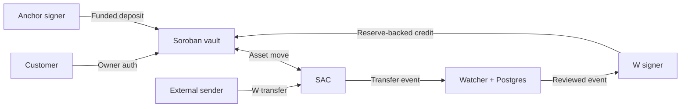

# MuxVault

MuxVault is a Stellar-only omnibus vault. A single Stellar Asset Contract (SAC) holds the pooled reserve. A Soroban contract records each customer's claim, and the customer authorizes withdrawals with their Stellar address. Deposits and withdrawals move the SAC asset and update the subledger in the same invocation.

The project includes a browser dashboard, a Rust vault, a TypeScript transaction SDK, a PostgreSQL-backed W-transfer watcher, an operator CLI, and a controlled SEP-24 deposit adapter. See [architecture](docs/architecture.md), [threat model](docs/threat-model.md), and [operations runbook](docs/operations-runbook.md).

## Architecture at a glance



## Try the Testnet dashboard

Install Node.js 24, then run these commands from the project directory.

```bash
npm ci
npm run web
```

Open the local URL printed by Vite. The dashboard connects to the shared XLM vault on Stellar Testnet. Testers use the same contract, with a separate subaccount for each registration. [Testnet deployment](https://stellar.expert/explorer/testnet/tx/57063ebf30147e7e845225e7e315e8699b803bbed9486775c355857cc72e4e17)

1. Select **Create demo wallet** and wait for Friendbot funding. You can also select **Connect Freighter** with the extension set to Stellar Testnet.
2. Select **Open subaccount**. Wait for the ID and a zero XLM balance to appear.
3. Select **Deposit**, enter **2**, then select **Deposit XLM**.
4. Select **Withdraw**, enter **0.5**, and leave the recipient blank to use the connected wallet.
5. Confirm **1.50 XLM** in **Your subaccount**. **Recent activity** links each confirmed transaction to the Testnet explorer. Vault reserve and liabilities reflect the shared contract.

The demo signing key lives in the tab's memory. Withdraw the test balance before refreshing or closing that tab. Freighter keeps control of its own keys. To restore a Freighter subaccount on another browser, connect the same wallet and enter its ID under **Use an existing subaccount**.

The dashboard uses atomic XLM deposits and withdrawals. Direct W-address reconciliation and the controlled anchor integration are operator flows described below.

## Build and serve the frontend

```bash
npm run typecheck
npm test
npm run web:build
npm run web:preview
```

The production build is a static site in `frontend/dist`. To serve a copy of that directory directly, run `python3 -m http.server 8080 --directory frontend/dist` and open `http://localhost:8080`. Use HTTPS for hosted deployments. Browser storage holds public subaccount IDs, transaction references, and activity. Pending confirmations can be checked with **Refresh** before submitting again.

To target a different XLM Testnet vault, edit `frontend/public/testnet.json` and rebuild. Use the deployed contract ID for `vault`, a funded public G-address for `readAccount`, and a browser-accessible HTTPS Testnet RPC for `rpcUrl`. The frontend verifies the network passphrase, protocol, asset, and contract schema before enabling writes. See the [public deployment manifest](docs/testnet-deployment.json).

## Build and test the contract

Install [Rustup](https://rustup.rs/), [Stellar CLI 30.0.1](https://github.com/stellar/stellar-cli/releases/tag/v30.0.1), and [Node.js 24](https://nodejs.org/). The project pins Rust 1.99.1 and Soroban SDK 29.0.1. Use the Stellar CLI build command so the contract specification is processed before deployment. The Rust contract uses ordinary Soroban addresses and works from Protocol 29. W-address workflows require Protocol 30 and use Stellar JavaScript SDK 17.3.0. [Bell upgrade guide](https://stellar.org/blog/developers/bell-protocol-30-upgrade-guide)

```bash
cargo test --workspace --locked
stellar contract build --locked
```

## Deploy your own Testnet vault

Copy `.env.example` to `.env`. Set `ASSET=native` for a quick XLM demo or `ASSET=CODE:ISSUER_G_ADDRESS` for an issued Testnet asset. For an issued asset, use a controlled issuer, set up the customer's and funder's trustlines, and fund both accounts with the asset. The deployment script derives the network-specific SAC address and deploys it if absent.

Create separate Testnet identities for the admin, funding signer, and guardian, plus a customer identity for the demo. An optional fifth identity acts as the W settlement signer. The following example funds the first four identities. Use fresh names if you already have keys with these aliases.

```bash
for role in admin funder guardian customer; do
  stellar keys generate "muxvault-$role" --network testnet --fund
done

stellar keys address muxvault-funder
stellar keys address muxvault-guardian
stellar keys address muxvault-admin
```

Set `FUNDING_ADDRESS`, `GUARDIAN_ADDRESS`, and `READ_ACCOUNT` in `.env` using the displayed public addresses. Enter the admin's development seed privately. That identity acts as the deployer and the default administrator.

```bash
read -rsp 'Testnet deployer seed: ' DEPLOYER_SEED; echo
export DEPLOYER_SEED
npm run deploy:testnet
unset DEPLOYER_SEED
```

Copy `VAULT_ID` and `WATCH_START_LEDGER` from the output into `.env`. The deployment command writes a manifest with the contract ID, asset, WASM hash, network, ledger, and transaction hash.

## Register, deposit, and withdraw

Enter the **customer** identity's seed when prompted. The deposit below adds 2 asset units and the withdrawal removes 0.5. The CLI takes integer base units. Replace the customer ID with the value printed by registration.

```bash
read -rsp 'Testnet customer seed: ' MUXVAULT_SIGNER_SEED; echo
export MUXVAULT_SIGNER_SEED
npm run operator -- register

CUSTOMER_ID=1
RECIPIENT="$(stellar keys address muxvault-customer)"
npm run operator -- deposit "$CUSTOMER_ID" 20000000
npm run operator -- account "$CUSTOMER_ID"
npm run operator -- withdraw "$CUSTOMER_ID" "$RECIPIENT" 5000000
npm run operator -- health
unset MUXVAULT_SIGNER_SEED
```

For the first customer on an empty vault, `health` should report reserve and liabilities of `15000000`, with `healthy` set to `true`. Read commands use a funded public `READ_ACCOUNT` to simulate. The SDK returns unsigned prepared transactions so your wallet or signing service can authorize them.

## Anchor and W deposit flows

Run PostgreSQL locally and apply the schema. The database tracks event evidence and settlement attempts. The contract remains authoritative for balances and receipts.

```bash
docker run --name muxvault-postgres \
  -e POSTGRES_USER=muxvault -e POSTGRES_PASSWORD=muxvault -e POSTGRES_DB=muxvault \
  -p 127.0.0.1:5432:5432 -d postgres:18
npm run db:migrate
```

For the anchor flow, set `MOCK_CUSTOMER_ID` to the registered customer, choose a mock payment ID, and set a private `ANCHOR_MOCK_TOKEN` of at least 16 characters. Start `npm run anchor:mock` in a second terminal. In the operator terminal, set `MUXVAULT_SIGNER_SEED` to the **funder** seed and run the following twice. The second run returns the same receipt without paying again.

```bash
npm run operator -- anchor-credit deposit-1
npm run operator -- anchor-credit deposit-1
```

For direct W transfers, generate a separate W settlement key. Start `npm run watch` in another terminal. With the **admin** seed loaded, enable the W role and obtain the customer's W destination.

```bash
stellar keys generate muxvault-w-signer --network testnet --fund
W_SIGNER="$(stellar keys address muxvault-w-signer)"
FUNDING="$(stellar keys address muxvault-funder)"
npm run operator -- set-signers "$FUNDING" "$W_SIGNER"
npm run operator -- w-address "$CUSTOMER_ID"
```

With a funded **customer** seed loaded, send directly to the displayed W address after the customer's registration ledger has closed. The transfer raises the vault reserve. Customer liabilities rise when the W signer reviews and credits the event.

```bash
npm run operator -- send-w "$W_ADDRESS" 1000000
npm run operator -- queue

# Load the W settlement signer's seed before running this command.
npm run operator -- w-credit "$EVENT_ID"
npm run operator -- health
```

Use the W event ID from `queue`. Keep the W signer disabled with `set-signers FUNDING_ADDRESS off` for deployments that only use atomic deposits. See the [operations runbook](docs/operations-runbook.md) for issuer controls, TTL, and history gaps. The supplied anchor is a loopback fixture for the settlement edge. A partner pilot requires authenticated fiat readiness and a partner-specific SEP-24 integration.

## Repository map

| Path | Purpose |
| --- | --- |
| `frontend` | Testnet wallet onboarding, vault dashboard, and transaction activity |
| `contracts/vault` | Custody, authorization, reserve accounting, receipts, and Soroban tests |
| `packages/sdk-ts` | Typed reads, unsigned transactions, asset derivation, and W addresses |
| `services/event-watcher` | SAC event ingestion, PostgreSQL checkpointing, and reviewed W credits |
| `services/anchor-adapter` | Controlled SEP-24 status and atomic funded payouts |
| `scripts` | Operator commands, Testnet deployment, and database migration |
| `tests` | SDK and offchain tests |
