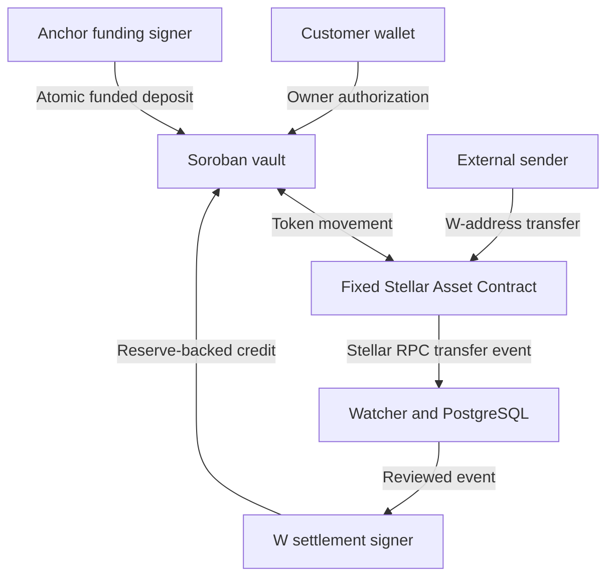

# MuxVault architecture

MuxVault binds one deployed vault to the SAC derived from serialized Stellar Asset XDR. The constructor runs as part of deployment and fixes the asset before any user can call the contract. The deployer supplies three distinct addresses for administration, anchor funding, and emergency pause. The administrator may configure a separate external W settlement signer.

## Onchain data

| Record | Key | Fields |
| --- | --- | --- |
| Core | `Core` | Immutable asset, role addresses, pause flag, schema version, next customer ID, total liabilities |
| Subaccount | `Customer(u64)` | Owner, balance in base units, active flag, registration ledger |
| Settlement receipt | `Reference(BytesN<32>)` | Settlement kind, customer ID, amount, credit ledger |

All three record types use persistent storage. Customer IDs start at 1 and are never reused. Registration requires owner consent. Owner rotation requires both old and new owner authorization. An admin can deactivate a zero-balance ID. An inactive ID keeps its historical record.

`deposit` requires owner authorization and moves funds from the owner. `anchor_deposit_for` requires the funding signer and transfers funds from that signer. Both check the live reserve before the transfer and verify its exact increase before writing the credit. `withdraw` checks the mapped owner's authorization over the customer ID, recipient, and amount. The debit and SAC transfer are atomic.

`settle_external_w_deposit` credits an already received transfer against reserve surplus. The separate signer attests to the transfer. The customer must have registered in an earlier ledger than the event. `health` reports reserve, liabilities, SAC authorization, and pause state. An issuer action can change the reserve independently of the vault.

## Event and anchor identity

The watcher uses the SAC transfer event's base destination and `to_muxed_id` u64. CAP-84 W addresses encode the same vault and ID. Before displaying or sending to a customer destination, the operator verifies the RPC network, protocol, vault, and active customer registration. [CAP-84](https://github.com/stellar/stellar-protocol/blob/master/core/cap-0084.md)

The W reference is SHA-256 over a JSON array with a versioned domain, hashed network passphrase, vault, SAC, transaction hash, and RPC event ID. The anchor reference binds the same network, vault and asset to the stable anchor namespace and payment ID. The amount and customer ID are bound separately by the first successful receipt. Changing the amount or customer ID on retry leaves the reference unchanged.

PostgreSQL writes a page of W observations and the watcher checkpoint in one transaction. It constrains both event IDs and event positions. The anchor adapter records an immutable payment intent before submission. Both settlement paths journal attempted transaction hashes and consult the onchain receipt before retrying.

The anchor adapter fetches an authenticated `/transaction` response from the controlled mock. It requires a separate fiat-readiness assertion, matching vault and network, and absence of an existing Stellar payout. `pending_stellar` already indicates a submitted payout and `completed` indicates completion under SEP-24. [SEP-24](https://github.com/stellar/stellar-protocol/blob/master/ecosystem/sep-0024.md)
